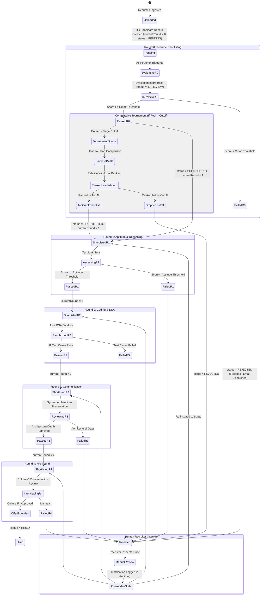
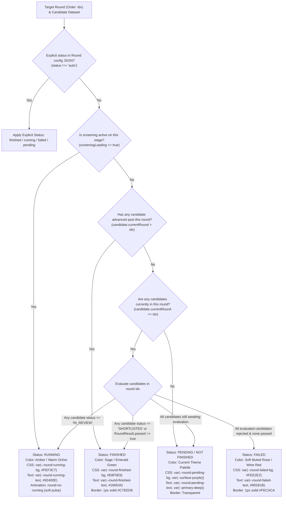
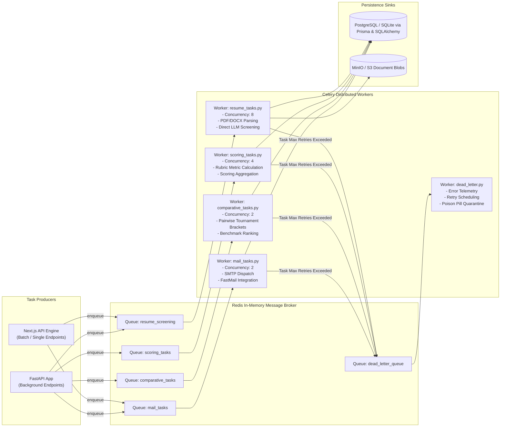
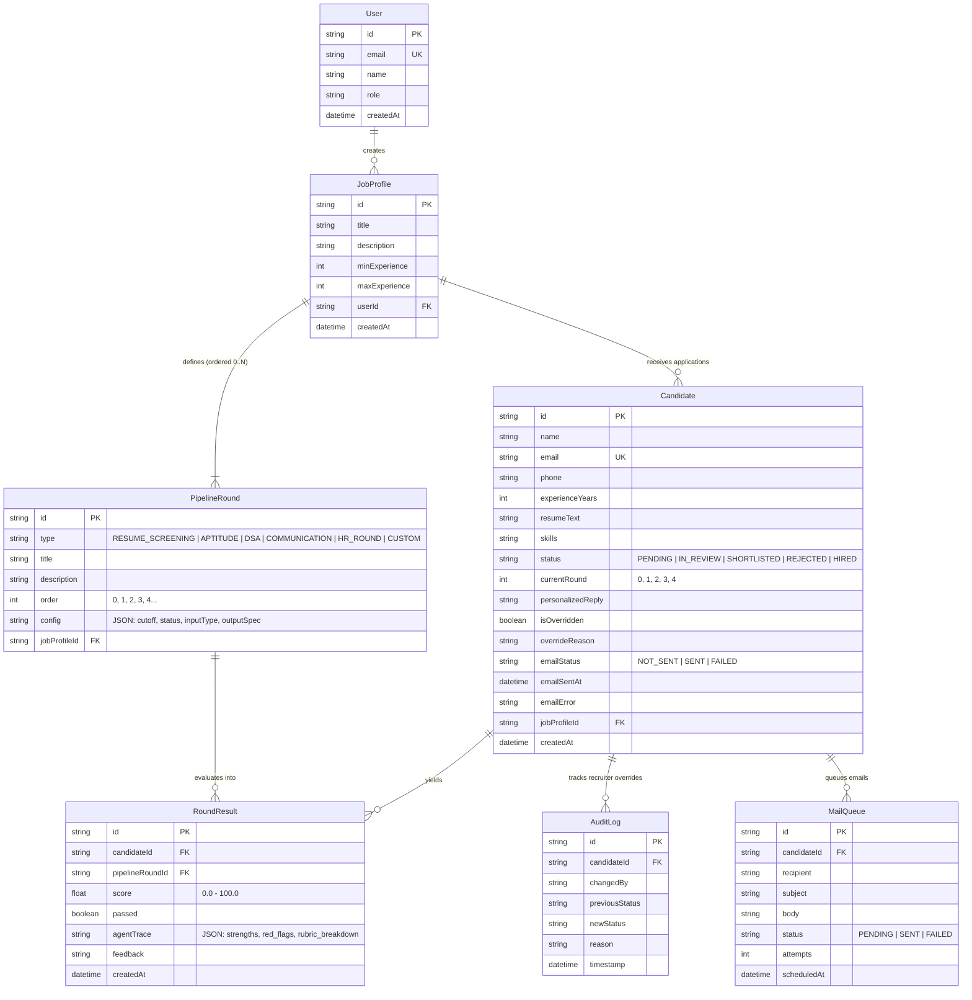

# TalentBench Core Mindmap

> Visual architectural graph of core system components, algorithmic engines, background workers, and data flow. Presentation and UI/UX layers are strictly excluded.

```mermaid
graph TD
    %% ROOT
    TB["TalentBench Core System"]

    %% MAIN SUBDOMAINS
    TB --> INGEST["1. Ingestion & Document Parsing"]
    TB --> LLM["2. LLM Gateway & Provider Router"]
    TB --> SCREEN["3. AI Screening & Scoring Engine"]
    TB --> TOURN["4. Comparative Tournament & Cutoffs"]
    TB --> PIPE["5. Multi-Stage Rounds Coordinator"]
    TB --> QUEUE["6. Distributed Task Queues & Celery Workers"]
    TB --> EMAIL["7. Outbound Transactional Mail Engine"]
    TB --> DATA["8. Data Layer & Schema Entities"]
    TB --> APIS["9. Core API Gateway Endpoints"]

    %% 1. INGESTION
    INGEST --> P_PDF["PDF Extraction\n(pdfjs / pdf_parser.py)"]
    INGEST --> P_DOC["DOCX Extraction\n(mammoth / docx_parser.py)"]
    INGEST --> P_XLS["Excel & CSV Parsing\n(SheetJS / excel_parser.py)"]
    INGEST --> P_SKILL["Skill & Experience Extractor\n(Regex heuristics & token matcher)"]
    INGEST --> P_S3["Object Storage Client\n(MinIO / S3 document store)"]

    %% 2. LLM GATEWAY
    LLM --> GW_ROUTER["Gateway Router\n(llm-gateway.ts / gateway.py)"]
    GW_ROUTER --> PROV_GEMINI["Primary: Google Gemini\n(gemini-2.5-flash)"]
    GW_ROUTER --> PROV_GROQ["Secondary: Groq Cloud\n(llama-3.3-70b-versatile)"]
    GW_ROUTER --> PROV_MOCK["Fallback: Deterministic Mock\n(Zero-latency local fallback)"]
    LLM --> GW_LIMIT["Rate Limiter\n(Token bucket & sliding window)"]
    LLM --> GW_GUARD["Guardrails Validator\n(Strict JSON schema & 0-100 score bounds)"]
    LLM --> GW_CACHE["Redis Prompt Cache\n(SHA-256 hash matching)"]

    %% 3. SCREENING & SCORING
    SCREEN --> SC_SINGLE["Single Resume Screener\n(screen-single / resume_screener.ts)"]
    SCREEN --> SC_JD["JD Strict Criteria Matcher\n(Tech stack & experience compliance)"]
    SCREEN --> SC_TRACE["Agent Reasoning Trace Generator\n(Structured JSON decision traces)"]
    SCREEN --> SC_RUBRIC["Weighted Scoring Rubric\n(Criteria penalty calculation)"]
    SCREEN --> SC_BATCH["Batch Screening Pipeline\n(Parallel queue execution)"]

    %% 4. TOURNAMENT & RANKING
    TOURN --> TN_GATE["Cutoff Gate Evaluator\n(Auto-activates when pool > cutoff)"]
    TOURN --> TN_PAIR["Pairwise Head-to-Head Evaluator\n(Direct candidate trade-off comparison)"]
    TOURN --> TN_ELO["Leaderboard & Win-Loss Aggregator\n(Elo / relative percentile scoring)"]
    TOURN --> TN_SLICE["Top-N Pool Slicer\n(Advances cutoff threshold pool)"]

    %% 5. MULTI-STAGE ROUNDS
    PIPE --> ST_SM["Rounds State Machine\n(Pending -> Running -> Finished -> Failed)"]
    PIPE --> R0["Round 0: Resume Shortlisting\n(AI initial criteria match)"]
    PIPE --> R1["Round 1: Aptitude & Reasoning\n(Cognitive & logic evaluation link)"]
    PIPE --> R2["Round 2: Coding & DSA\n(Live system algorithms & test execution)"]
    PIPE --> R3["Round 3: Communication\n(Architecture & presentation review)"]
    PIPE --> R4["Round 4: HR Round\n(Values, culture & comp alignment)"]
    PIPE --> ST_ADV["Candidate Round Progression\n(currentRound increment & RoundResult write)"]
    PIPE --> ST_OVR["Recruiter Manual Override Loop\n(Human-in-the-loop audit update)"]

    %% 6. DISTRIBUTED WORKERS
    QUEUE --> Q_REDIS["Redis Message Broker\n(Port 6379 / task queues)"]
    QUEUE --> W_RESUME["Resume Screening Worker\n(Concurrency: 8 / batch task runner)"]
    QUEUE --> W_SCORE["Scoring Worker\n(Criteria weight calculations)"]
    QUEUE --> W_COMP["Comparative Tournament Worker\n(Pool tournament tasks)"]
    QUEUE --> W_MAIL["Mail Dispatch Worker\n(Async outbound queue)"]
    QUEUE --> W_DEAD["Dead-Letter & Fault Queue\n(Retry policy & failure telemetry)"]

    %% 7. EMAIL ENGINE
    EMAIL --> EM_SRV["Email Service Engine\n(Nodemailer / aiosmtplib)"]
    EMAIL --> EM_INV["Personalized Interview Invitation\n(Shortlisted candidate details)"]
    EMAIL --> EM_REJ["Constructive Feedback Email\n(Detailed missing skills report)"]
    EMAIL --> EM_AUD["Delivery Status Auditor\n(NOT_SENT -> SENT / FAILED)"]

    %% 8. DATA LAYER
    DATA --> M_JOB["JobProfile / Role\n(JD, bounds, cutoffs, pipeline)"]
    DATA --> M_ROUND["PipelineRound\n(Type, order, config JSON)"]
    DATA --> M_CAND["Candidate\n(Resume, skills, status, currentRound)"]
    DATA --> M_RES["RoundResult\n(Score, passed, agentTrace, feedback)"]
    DATA --> M_LOG["AuditLog\n(Override reasons & recruiter actions)"]
    DATA --> M_USER["User & Org\n(JWT auth & role-based tenancy)"]

    %% 9. APIS
    APIS --> API_JOBS["/api/jobs & /api/jobs/:id\n(JobProfile CRUD & pipeline sync)"]
    APIS --> API_CAND["/api/candidates\n(Upload, batch screen, sync, report)"]
    APIS --> API_AI["/api/ai\n(screen-single & tournament execution)"]
    APIS --> API_OVR["/api/candidates/:id/override\n(Recruiter status override)"]
    APIS --> API_MAIL["/api/email/send\n(Single & bulk email dispatch)"]
    APIS --> API_XLS["/api/jobs/:id/export-excel\n(XLSX pool stream generation)"]
```

---

## 2. End-to-End Processing & Data Flow Graph

```mermaid
flowchart TD
    %% INGESTION
    A["Raw Resume Files\n(PDF, DOCX, TXT, Excel)"] --> B["Document Parser Subsystem\n(pdf_parser, docx_parser, excel_parser)"]
    B --> C["MinIO / S3 Storage\n(Raw File Archive)"]
    B --> D["Regex Skill & Experience Extractor\n(Normalized Candidate Metadata)"]
    
    %% DB STORAGE
    D --> E[("Database: Candidate Records\nstatus = PENDING, currentRound = 0")]
    
    %% RECRUITER TRIGGER
    E --> F["Batch Screening Trigger\n(/api/jobs/:id/candidates/screen-batch)"]
    
    %% QUEUE / WORKER
    F --> G["Redis Task Queue\n(resume_screening queue)"]
    G --> H["Celery Resume Worker Pool\n(High Concurrency: 8 workers)"]
    
    %% LLM GATEWAY
    H --> I["LLM Gateway\n(Provider Router & Token Bucket Limiter)"]
    I --> J{"Provider Availability"}
    J -->|Primary| K["Google Gemini 2.5 Flash"]
    J -->|Secondary| L["Groq Cloud Llama 3.3 70B"]
    J -->|Offline / Test| M["Deterministic Mock Engine"]
    
    K --> N["Output Guardrails & Schema Validator\n(Enforces JSON Structure & 0-100 Score)"]
    L --> N
    M --> N
    
    %% EVALUATION RESULT
    N --> O["Scoring Rubric Evaluator\n(Match Score, Experience Compliance, Red Flags)"]
    O --> P[("Database: RoundResult Write\nscore, passed, agentTrace, feedback")]
    
    %% CUTOFF & TOURNAMENT BRANCH
    P --> Q{"Shortlisted Pool > Stage Cutoff?"}
    Q -->|No| R["Standard Stage Progression"]
    Q -->|Yes| S["Comparative Tournament Engine\n(Pairwise Head-to-Head Ranking)"]
    
    S --> T["Leaderboard Slicing\n(Top-N Shortlisted, Remaining Cut Off)"]
    T --> R
    
    %% STAGE ADVANCEMENT
    R --> U[("Database: Update Candidate\ncurrentRound = 1, status = SHORTLISTED / REJECTED")]
    
    %% NOTIFICATION
    U --> V["Outbound Email Dispatcher\n(mail_tasks / email-service.ts)"]
    V --> W{"Candidate Status"}
    W -->|SHORTLISTED| X["Interview Invitation with Next Round Link"]
    W -->|REJECTED| Y["Constructive Feedback with Missing Skills Report"]
    
    X --> Z[("Database: Update candidate.emailStatus\nSENT / FAILED")]
    Y --> Z

    %% MANUAL OVERRIDE
    Z -.-> OA["Human Recruiter Review"]
    OA -.->|Manual Override| OB["/api/candidates/:id/override\n(Status Change + Justification)"]
    OB -.->|Audit Write| OC[("Database: AuditLog Record\nisOverridden = true")]
```

---

## 3. Candidate Lifecycle & Round State Machine

---

## 4. Hiring Round Visual Status Resolution Graph

---

## 5. Distributed Worker & Queue Topology Graph

---

## 6. Core Database Entity-Relationship Graph

